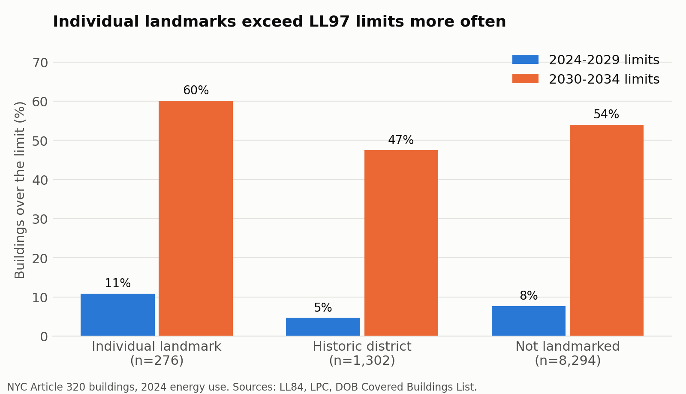
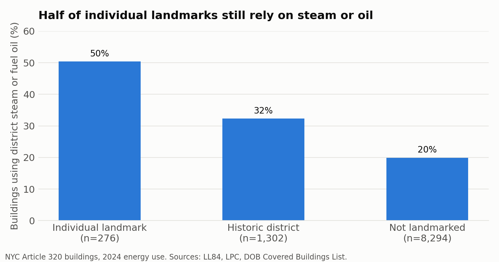
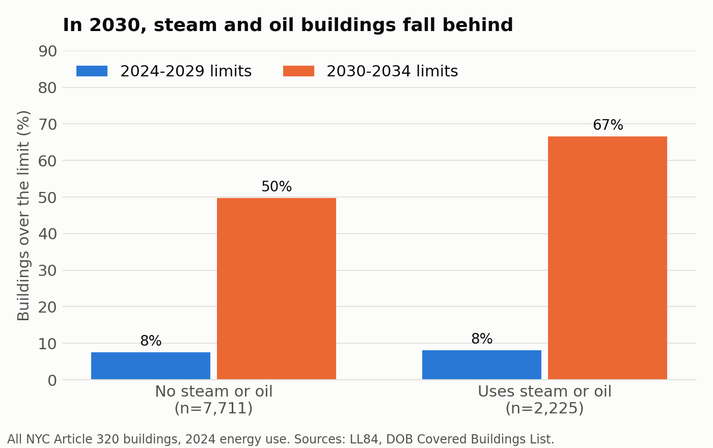
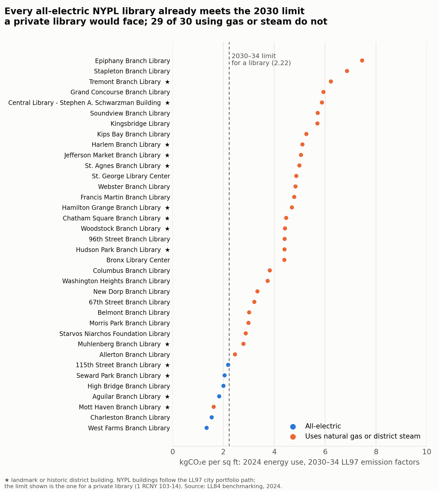

# NYC Landmarks under Local Law 97

How ready are New York City's landmarked buildings for the city's building carbon limits, and what holds them back?

**Interactive map:** https://tugesra.github.io/nyc-landmark-decarbonization/

This project matches NYC's building energy benchmarking data (Local Law 84) with the Landmarks Preservation Commission's building database and the Department of Buildings' Local Law 97 Covered Buildings List. It estimates which landmarked buildings exceed their LL97 carbon limits today and in 2030, and why.

## Which landmarks are covered

Most landmarked buildings are too small for LL97. Of 33,228 tax lots in the LPC database, 2,916 (9%) contain a building covered by LL97. About 1,800 of those follow Article 320 from 2024, and 1,578 of them have a usable 2024 energy report and are analysed here. The others either lack a usable report or follow other paths (rent-regulated housing from 2026, Article 321 for houses of worship and some affordable housing, or the city portfolio). The map shows them as grey dots, without an analysis.

## Key findings

Based on 2024 energy use of 9,872 buildings that must comply with LL97 Article 320 from 2024:



1. **Individual landmarks exceed their 2024–2029 limits 1.4 times as often as other buildings** (10.9% vs 7.7%). Much of the gap comes from their mix of uses: landmarks include more hotels, retail stores and schools. Within offices and apartment buildings, the 2024 rates are similar.

2. **Half of individual landmarks still rely on district steam or fuel oil**, 2.5 times the rate of non-landmarked buildings (50% vs 20%). Among landmarked offices the share is 48%.

   

3. **Heating fuel decides who falls behind in 2030.** At today's energy use, 67% of buildings on steam or oil would exceed their 2030–2034 limits, compared with 50% of other buildings. The reason is in the law's emission factors: the factor for grid electricity is halved in 2030 as the grid gets cleaner (0.000288962 → 0.000145 tCO₂e/kWh), while the factor for district steam barely changes (0.00004493 → 0.0000432 tCO₂e/kBtu). Electrified buildings improve automatically; steam and oil buildings do not.

   

4. **Buildings in historic districts, mostly apartment buildings, do better than average** (4.7% over the 2024–2029 limits).

5. **Landmarked hotels are the most exposed group**: 22% exceed their 2024–2029 limits and 74% would exceed the 2030–2034 limits.

| Group | Buildings | Median emissions (kgCO₂e/sq ft) | Over 2024–29 limit | Over 2030–34 limit | Use steam or oil | Max penalty from 2030 ($M/yr) |
|---|---|---|---|---|---|---|
| Individual landmark | 276 | 4.70 | 10.9% | 60.1% | 50.4% | 15.6 |
| Historic district | 1,302 | 4.05 | 4.7% | 47.5% | 32.3% | 17.1 |
| Not landmarked | 8,294 | 4.21 | 7.7% | 54.0% | 19.9% | 224.8 |
| All | 9,872 | 4.20 | 7.4% | 53.3% | 22.4% | 257.5 |

**What this means:** for landmarked buildings, the main LL97 challenge is switching away from steam and oil heating while respecting preservation rules, rather than efficiency alone. The problem is concentrated in a few building types: hotels, offices on district steam, and retail.

## Case study: NYPL's landmark libraries

New York Public Library buildings are city-owned, so LL97 covers them through the city portfolio requirements rather than building-by-building limits. Comparing them with the limit a private library of the same size would face is still instructive, because the portfolio shares one building type and one owner but differs in age and fuel. The 2024 data include 36 NYPL libraries, 14 of them landmarked.



- **29 of the 30 libraries that report natural gas or district steam in 2024 would exceed the 2030–2034 limit for a library.** The exception is Mott Haven, a 1905 branch in a historic district.
- The Central Library (Stephen A. Schwarzman Building), heated by district steam, would emit about 5.9 kgCO₂e per sq ft under the 2030 emission factors, against a library limit of 2.22.
- **Five libraries have incomplete fuel data.** The 115th Street, Seward Park and Aguilar branches (all individual landmarks) and the High Bridge and West Farms branches report no fossil fuel in 2024 but report natural gas in 2022, 2023 or 2025. Their 2024 emissions are understated, so the figure shows them separately. Only the Charleston branch (built 2021) reports no fossil fuel in any year.

The portfolio illustrates the main finding: almost every library that burns gas or uses steam, landmarked or not, is far from 2030-level performance. It also shows that a benchmarking record can omit a fuel entirely and make a building look electric; checking fuel use across several reporting years catches most such cases. Building-level results are in `outputs/nypl_buildings_2024.csv`.

## Method

1. **Benchmarking data.** Calendar year 2024 (the first LL97 compliance year) from the LL84 dataset. One record per property; standalone and parent properties only; 12 months of data; floor area above zero; no default values; site energy use intensity between 10 and 500 kBtu/sq ft (up to 1,000 for energy-intensive uses such as data centers and labs); duplicate reports of the same building removed.
2. **LL97 coverage.** Only tax lots listed on the DOB LL97 Covered Buildings List (filing year 2026) under compliance pathway CP0, Article 320 from 2024. This excludes city-owned buildings, houses of worship and rent-regulated or income-restricted housing, which follow other paths. 64 city-owned properties that sit on lots listed as CP0 are also removed, identified by their agency prefix (for example `DPR_` or `NYPL_`).
3. **Emissions.** Recomputed from each building's electricity, natural gas, district steam and fuel oil use with the LL97 emission coefficients for 2024–2029 and 2030–2034.
4. **Limits.** Built from each property's mix of ENERGY STAR property types and their floor areas, using the LL97 limits per property type. About 1.7% of floor area uses property types that are not in the limits table; these are mapped to the closest listed type (see `TYPE_MAP` in the analysis script).
5. **Landmark status.** A property is an individual landmark or a historic district building if its tax lot (BBL) appears in the LPC building database.
6. **Penalty.** Excess emissions × $268 per tCO₂e, the legal maximum.

### Validation

- Across all Article 320 buildings, the analysis finds 7.4% over the 2024–2029 limits and 53.3% over the 2030–2034 limits at the same energy use. The Department of Buildings reports that 5% of 2024 Article 320 filings were over their limits ([DOB, 2026](https://www.nyc.gov/assets/buildings/pdf/ll97yr1.pdf)); the official share covers only buildings that filed, after deductions and adjustments. For 2030, [Urban Green Council](https://www.urbangreencouncil.org/?p=10250) finds that 43% of covered buildings meet their limits on 2024 benchmarking data, close to the 46.7% implied here.
- LL84 records a missing fuel as "Not Available", which the analysis reads as zero. Of the 530 sample buildings with no fossil fuel in 2024, 207 report fossil fuel in 2022, 2023 or 2025. Dropping them changes the shares over the limits by at most one percentage point.
- Recomputed emissions correlate at 0.99 (log scale) with the emissions reported in LL84.
- A manual recalculation for the Empire State Building matches the script.

### Limitations

- Uses the ENERGY STAR property-type limits. For 2024–2029, owners may instead use the occupancy-group limits in the law, which are sometimes higher.
- Penalties are the legal maximum. Deductions, such as renewable energy credits and beneficial electrification credits, are not modeled.
- Benchmarking data are self-reported and may contain errors. Fuels missing from a record are read as zero (see Validation).
- Landmark status is matched by tax lot. A lot can contain both landmarked and non-landmarked buildings.

## Data sources

- [NYC Building Energy and Water Data Disclosure for Local Law 84 (2023–present)](https://data.cityofnewyork.us/d/5zyy-y8am), NYC Open Data
- [LPC Individual Landmark and Historic District Building Database](https://data.cityofnewyork.us/d/gpmc-yuvp), NYC Open Data
- [DOB Sustainability Laws Covered Buildings List 2026](https://www.nyc.gov/assets/buildings/excel/cbl26.xlsx), NYC Department of Buildings
- LL97 limits and emission coefficients: [NYC Administrative Code, Title 28, Article 320](https://codelibrary.amlegal.com/codes/newyorkcity/latest/NYCadmin/0-0-0-158933) and [1 RCNY §103-14](https://www.nyc.gov/assets/buildings/rules/1_RCNY_103-14.pdf). The limits table was first compiled from [greencalculus.com](https://greencalculus.com/standards/nyc-local-law-97/) and spot-checked against the rule; values are rounded to two decimals.
- Basemap: © OpenStreetMap contributors © CARTO

## Repository contents

| Path | Contents |
|---|---|
| `scripts/01_extract_ll84.py` | Extracts the needed columns from the LL84 download |
| `scripts/02_ll97_landmark_analysis.py` | Cleaning, LL97 emissions and limits, landmark matching, summaries |
| `scripts/03_figures.py` | Figures in `figures/` |
| `scripts/05_nypl_case_study.py` | NYPL case study table and figure |
| `scripts/04_map_data.py` | GeoJSON for the web map (analysed buildings and other LL97-covered landmarks) |
| `data/` | LL97 limits table and LL97 pathway by tax lot |
| `outputs/` | Building-level results and summary tables |
| `docs/` | Interactive map (GitHub Pages) |

## Reproduce

Download the LL84 and LPC datasets above as CSV into the folder above this repository, then:

```bash
pip install pandas matplotlib openpyxl
python scripts/01_extract_ll84.py <LL84 CSV> data/ll84_selected.csv
python scripts/02_ll97_landmark_analysis.py 2024
python scripts/03_figures.py
python scripts/04_map_data.py
```

## About

By **Esra Tug**. This project builds on my master's capstone, *Decarbonizing NYC Buildings, Case Study: New York Public Library* (Pace University, 2024), and my work on the [NYPL Energy & Sustainability Map](https://github.com/tugesra/NYPLEnergyMap).

Status: preliminary analysis, November 2026.

## How to cite

> Tug, E. (2026). *NYC Landmarks under Local Law 97* [Software and data analysis]. https://github.com/tugesra/nyc-landmark-decarbonization

## License

Code: MIT License (see `LICENSE`). Source data belong to their publishers listed above.
